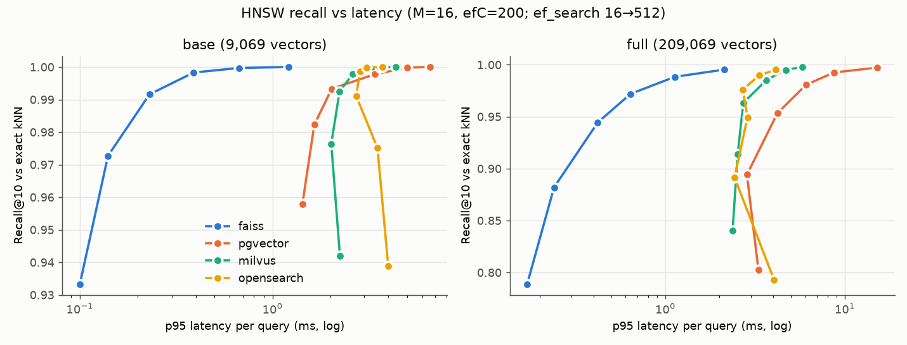

# Results

## Build and ANN (k=10)

| scale | store | vectors | build s | size MB | container mem | ef @R≥0.95 | recall | p50 ms | p95 ms | QPS c=1/8/32 |
|---|---|---|---|---|---|---|---|---|---|---|
| base | faiss | 9069 | 1.1 | 37 | - | 32 | 0.9727 | 0.11 | 0.14 | 2722 / 7742 / 6773 |
| base | pgvector | 9069 | 6.1 | 137 | 267.3MiB / 6GiB | 16 | 0.9579 | 1.16 | 1.43 | 424 / 699 / 674 |
| base | milvus | 9069 | 18.7 | - | 1.684GiB / 6GiB | 32 | 0.9764 | 1.75 | 2.02 | 410 / 1420 / 1509 |
| base | opensearch | 9069 | 14.9 | 81 | 3.936GiB / 6GiB | 32 | 0.9751 | 2.48 | 3.51 | 450 / 1073 / 1117 |
| full | faiss | 209069 | 65.6 | 845 | - | 128 | 0.9719 | 0.51 | 0.64 | 1784 / 5304 / 4755 |
| full | pgvector | 209069 | 213.7 | 3064 | 2.786GiB / 6GiB | 64 | 0.9533 | 2.96 | 4.21 | 232 / 760 / 610 |
| full | milvus | 209069 | 217.2 | - | 3.434GiB / 6GiB | 64 | 0.9632 | 2.25 | 2.72 | 352 / 777 / 589 |
| full | opensearch | 209069 | 491.8 | 1843 | 5.45GiB / 6GiB | 128 | 0.9761 | 2.12 | 2.7 | 460 / 1093 / 1143 |

## Filtered search (ef=128, filter `tenant < x`, recall vs exact filtered kNN)

| scale | store | 1%: recall / p95 | 10%: recall / p95 | 50%: recall / p95 |
|---|---|---|---|---|
| base | faiss | 0.6946 / 0.45 | 0.9639 / 0.42 | 0.996 / 0.43 |
| base | pgvector | 1.0 / 1.54 | 1.0 / 4.68 | 0.9962 / 3.18 |
| base | milvus | 1.0 / 2.04 | 0.9985 / 3.75 | 0.9953 / 2.9 |
| base | opensearch | 1.0 / 3.43 | 1.0 / 2.28 | 0.9952 / 2.42 |
| full | faiss | 0.5294 / 0.76 | 0.86 / 0.72 | 0.953 / 0.78 |
| full | pgvector | 1.0 / 14.04 | 0.9002 / 21.61 | 0.9661 / 20.71 |
| full | milvus | 1.0 / 3.05 | 0.9883 / 5.64 | 0.9697 / 3.58 |
| full | opensearch | 0.5386 / 3.81 | 0.8619 / 3.14 | 0.9582 / 2.79 |

## Retrieval quality on synthetic qrels (598 queries)

| scale | store | pipeline | nDCG@10 | MRR@10 | R@10 | R@50 | R@100 |
|---|---|---|---|---|---|---|---|
| base | faiss | dense | 0.7934 | 0.7396 | 0.9582 | 0.9883 | 0.9916 |
| base | faiss | dense+rerank | 0.9036 | 0.8755 | 0.9866 | 0.9883 | 0.9883 |
| base | pgvector | dense | 0.7934 | 0.7396 | 0.9582 | 0.9883 | 0.9916 |
| base | pgvector | bm25 | 0.8108 | 0.774 | 0.9231 | 0.9532 | 0.9599 |
| base | pgvector | hybrid | 0.8284 | 0.7869 | 0.9532 | 0.9849 | 0.99 |
| base | pgvector | hybrid+rerank | 0.9007 | 0.8732 | 0.9816 | 0.9849 | 0.9849 |
| base | milvus | dense | 0.7934 | 0.7396 | 0.9582 | 0.9883 | 0.9916 |
| base | milvus | bm25 | 0.8104 | 0.7726 | 0.9264 | 0.9532 | 0.9599 |
| base | milvus | hybrid | 0.8245 | 0.7825 | 0.9498 | 0.9866 | 0.99 |
| base | milvus | hybrid+rerank | 0.9024 | 0.8748 | 0.9833 | 0.9866 | 0.9866 |
| base | opensearch | dense | 0.7934 | 0.7396 | 0.9582 | 0.9883 | 0.9916 |
| base | opensearch | bm25 | 0.8195 | 0.7838 | 0.9281 | 0.9565 | 0.9699 |
| base | opensearch | hybrid | 0.8248 | 0.781 | 0.9565 | 0.9883 | 0.99 |
| base | opensearch | hybrid+rerank | 0.904 | 0.8765 | 0.9849 | 0.9883 | 0.9883 |
| full | faiss | dense | 0.7315 | 0.6832 | 0.8813 | 0.9415 | 0.9532 |
| full | faiss | dense+rerank | 0.8539 | 0.8263 | 0.9365 | 0.9415 | 0.9415 |
| full | pgvector | dense | 0.7322 | 0.6836 | 0.8829 | 0.9448 | 0.9565 |
| full | pgvector | bm25 | 0.7412 | 0.705 | 0.8528 | 0.9047 | 0.9147 |
| full | pgvector | hybrid | 0.7725 | 0.729 | 0.9047 | 0.9532 | 0.9649 |
| full | pgvector | hybrid+rerank | 0.8625 | 0.8335 | 0.9498 | 0.9532 | 0.9532 |
| full | milvus | dense | 0.7311 | 0.6827 | 0.8813 | 0.9431 | 0.9532 |
| full | milvus | bm25 | 0.7368 | 0.6972 | 0.8595 | 0.9064 | 0.9264 |
| full | milvus | hybrid | 0.7743 | 0.7296 | 0.9097 | 0.9548 | 0.9666 |
| full | milvus | hybrid+rerank | 0.8624 | 0.8334 | 0.9498 | 0.9548 | 0.9548 |
| full | opensearch | dense | 0.7313 | 0.6829 | 0.8813 | 0.9431 | 0.9565 |
| full | opensearch | bm25 | 0.7522 | 0.716 | 0.8629 | 0.913 | 0.9281 |
| full | opensearch | hybrid | 0.7795 | 0.7362 | 0.9114 | 0.9582 | 0.9732 |
| full | opensearch | hybrid+rerank | 0.8657 | 0.836 | 0.9548 | 0.9582 | 0.9582 |

## Query latency, dense top-100 (ef=256) and BM25 top-100

| scale | store | dense p50 / p95 | bm25 p50 / p95 |
|---|---|---|---|
| base | faiss | 0.57 / 0.69 | - |
| base | pgvector | 3.98 / 4.8 | 2.43 / 78.06 |
| base | milvus | 2.9 / 3.38 | 2.29 / 3.02 |
| base | opensearch | 4.55 / 5.35 | 3.81 / 5.12 |
| full | faiss | 1.02 / 1.31 | - |
| full | pgvector | 34.23 / 67.29 | 90.74 / 161.6 |
| full | milvus | 3.64 / 4.32 | 3.03 / 4.22 |
| full | opensearch | 5.68 / 6.85 | 4.98 / 6.6 |

## Model latency on the PGX (ms)

| step | p50 | p95 | p99 |
|---|---|---|---|
| embed_1_query | 16.28 | 20.37 | 26.46 |
| rerank_50_docs | 240.26 | 267.57 | 283.78 |
